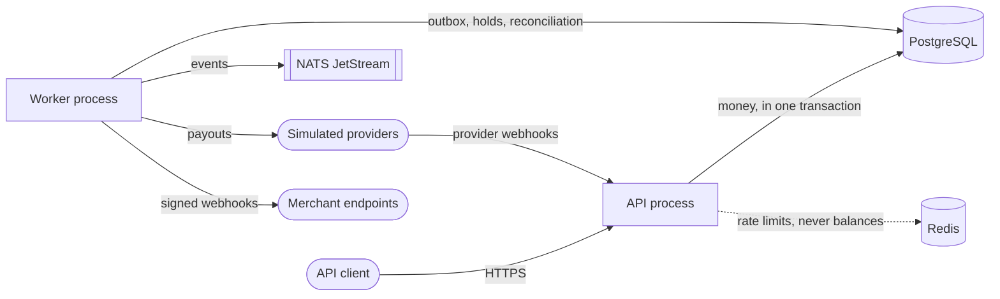

# Ledger

**A double-entry wallet and payments engine where every transaction sums to zero — always.**

Ledger is the backend core of a digital wallet (think Nequi or Cash App): user and merchant wallets, P2P transfers, merchant payments with fees, holds (authorize → capture / void), refunds, cash-in and cash-out through simulated providers, and signed webhooks.

It is built to prove one guarantee under real-world failure: **money is never created, lost or applied twice** — not with 10,000 concurrent transfers, not with duplicated requests, not when a worker dies mid-payout.

**How:**
- Immutable double-entry ledger; balances are projections rebuilt from it
- Idempotency keys and unique references on every money movement
- Ordered row locking in PostgreSQL — no deadlocks, no double spending
- Transactional outbox → NATS JetStream for reliable event publishing with idempotent consumers
- Sagas with compensation for external payouts
- Nightly reconciliation that proves the books balance

> Simulated money only. No real funds, banks or KYC.

## Architecture

A modular monolith: one codebase, two processes, and PostgreSQL as the only source of truth for money.

## Status

Phase 0 (design) is complete. The design, schema draft and API contract are written, and the engine itself is not built yet.

## Documentation

**Design**
- [Overview](docs/design/overview.md): what Ledger is and what it is not
- [Invariants](docs/design/invariants.md): the 7 rules that must always hold, and how each is enforced
- [Money flows](docs/design/money-flows.md): every operation as accounting entries
- [Data model](docs/design/data-model.md): schema decisions and ER diagram

**API**
- [OpenAPI contract](api/openapi.yaml): the v0.1 API

**Architecture decisions**
- [ADR-0001](docs/adr/0001-ledger-is-the-source-of-truth.md): the ledger is the source of truth
- [ADR-0002](docs/adr/0002-modular-monolith.md): modular monolith
- [ADR-0003](docs/adr/0003-concurrency-control.md): pessimistic row locks in ID order
- [ADR-0004](docs/adr/0004-money-as-int64-minor-units.md): money as int64 in minor units
