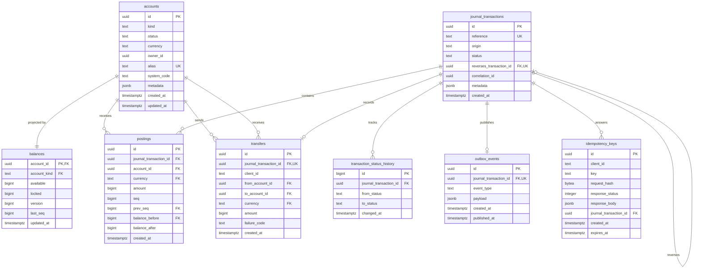

# Data Model

The schema for v0.1. The draft lives in [`migrations/0001_init.up.sql`](../../migrations/0001_init.up.sql), which is the reference for exact columns and constraints.

## Decisions

| Decision | Choice | Why |
|---|---|---|
| ID type | UUIDv7, generated in Go | Time-ordered, which is good for indexes. PostgreSQL 16 has no native `uuidv7()`, so columns have no default. A UUIDv7 reveals its creation time; that is acceptable for these resources. |
| Amounts in SQL | `BIGINT` + `CHECK (amount <> 0)` on postings | Matches `int64` in Go. No `NUMERIC` with decimals and no `REAL`. |
| Amounts in JSON | Integer in minor units plus a `currency` field | Same as Stripe. Maximum absolute amount is `9007199254740991` (2^53 − 1), the largest integer every JSON client reads exactly. |
| Dates | `TIMESTAMPTZ`, always UTC | No time zone ambiguity. |
| Statuses | `TEXT` + `CHECK (status IN (...))` | Easier to migrate than a PostgreSQL `ENUM`. |
| Idempotency | Unique per `(client_id, key)`, valid for 24 h | Industry standard. A SHA-256 of the request detects a key reused with another body. |

## Diagram



## Tables

### `accounts`

A place that holds money. User and merchant accounts need an `owner_id` and an `alias`; system accounts need a `system_code` instead (`accounts_identity_by_kind`). `status` drives the `account_frozen` error.

- **Unique:** `alias`, `(system_code, currency)`, and `(owner_id, kind, currency)`, so each owner has one wallet per currency.
- **Composite targets:** `(id, kind)` and `(id, currency)` exist so other tables can reference them.

### `balances`

The stored projection, and the row locked with `SELECT … FOR UPDATE` before any change.

- **`available` + `locked`** is the account's total.
- **`account_kind`** is a copy of `accounts.kind`, kept correct by `balances_account_fk`. A `CHECK` cannot read another table, and non-negativity depends on the kind.
- **`version`** counts changes, holds included. It is not concurrency control ([ADR-0003](../adr/0003-concurrency-control.md)).
- **Checks:** `balances_available_non_negative`, `balances_locked_non_negative`, `balances_system_never_locked`.

Every account needs its row in the same transaction that creates it; a posting to an account without one fails `balance_matches_ledger`.

### `journal_transactions`

One money movement. Only `status` can change, along these paths:

```text
created → pending → completed → reversed
              └───→ failed
```

- **Unique:** `journal_transactions_reference_unique` on `reference`, stored as `<client_id>:<client reference>`. A failed transaction keeps its reference, so a new attempt needs a new one.
- **Reversals:** `journal_transactions_reverses_once` limits each transaction to one reversal.
- **`origin`:** only the v0.1 values `transfer`, `reversal` and `cash_in`. Later phases extend the `CHECK`.

### `postings`

One signed line on one account. Insert-only.

- **Checks:** `postings_amount_non_zero`, `postings_amount_limit`, `postings_balance_math`, `postings_chain_start`.
- **Foreign keys:** `postings_account_currency_fk` keeps the currency equal to the account's, and `postings_chain_fk` links each posting to the previous one.
- **Unique:** `postings_account_seq_unique` and `postings_chain_anchor`.
- **Indexes:** `postings_account_created_idx` on `(account_id, created_at, id)` and `postings_journal_transaction_idx`.

**The chain.** `seq` numbers an account's postings 1, 2, 3… and `prev_seq` always equals `seq − 1`. `postings_chain_fk` then requires that `(account_id, prev_seq, balance_before)` matches an existing `(account_id, seq, balance_after)`. A posting that does not start exactly where the previous one ended cannot be inserted. The cost is one extra unique index on the busiest table.

**History uses `seq` as its cursor, not `created_at`.** `now()` returns the time the database transaction started. If T1 starts first but waits for a lock, it commits after T2 with an earlier `created_at`, and a date cursor already past that point skips T1's posting forever. `seq` is assigned under the lock, so it has no gaps and no reordering. `postings_account_created_idx` remains for date-range queries.

### `transaction_status_history`

Append-only log of every status change, written by `journal_status_audit`. It is the one table with a `BIGINT` identity key, because a trigger has no UUIDv7 generator.

### `transfers`

The product record of a P2P transfer. It has no `status` column: the status lives on the journal transaction, and a second copy could drift. `failure_code` explains a failed transfer. `transfers_distinct_accounts` rejects sending money to the same account.

### `idempotency_keys`

- **Unique:** `idempotency_keys_client_key_unique` on `(client_id, key)`.
- **One commit:** the key, the money and the stored response commit together. The row is inserted first, so a concurrent duplicate waits on the unique key. If the process dies after `COMMIT`, a retry finds the stored response.
- **Expiry:** after `expires_at` a key may be reused, so `reference` remains as the second defense. A retry after 24 h fails with `duplicate_reference` instead of moving money twice.

`response_status` and `response_body` are nullable only because they are filled after the insert, within the same transaction.

### `outbox_events`

Not in the original v0.1 table list. Invariant 7 needs it from the first transaction, and adding it in phase 4 would mean backfilling history. Phase 4 adds the publisher.

`outbox_events_one_per_transaction` allows at most one event per transaction, and `outbox_required` requires at least one. A reversal is its own transaction, so it has its own event.

## Triggers

| Trigger | When | What it does |
|---|---|---|
| `postings_immutable`, `postings_no_truncate` | Before update, delete, truncate | Rejects any change to `postings` |
| `transaction_status_history_immutable`, `transaction_status_history_no_truncate` | Before update, delete, truncate | Rejects any change to the history |
| `journal_transactions_no_delete`, `journal_transactions_no_truncate` | Before delete, truncate | Keeps every transaction |
| `balances_no_delete`, `balances_no_truncate` | Before delete, truncate | Keeps every account visible to `balance_matches_ledger` |
| `journal_status_guard` | Before insert, update | New rows start as `created`; only `status` changes, and only along valid paths; a reversal cannot be reversed |
| `journal_status_audit` | After insert, update | Writes `transaction_status_history` |
| `postings_require_pending` | Before insert | Postings can only be added to a `pending` transaction |
| `journal_balanced` | Deferred to `COMMIT` | `completed` or `reversed` needs at least 2 postings summing to 0 per currency; any other status needs 0 postings |
| `balance_matches_ledger` | Deferred to `COMMIT` | `available + locked` and `last_seq` must match the account's last posting |
| `outbox_required` | Deferred to `COMMIT` | A confirmed transaction must have its event |

`journal_balanced` fires on both `postings` and `journal_transactions`. A trigger on `postings` alone would never run for a transaction completed with no postings.

`balance_matches_ledger` is O(1). The chain starts at 0 and each link adds its amount, so the last `balance_after` is already the sum of the account's postings.

## Known limits

- **Database role:** triggers only protect against the application if it does not own the tables, because an owner can disable them. Phase 1 must create a separate role with no `TRIGGER`, `TRUNCATE` or `UPDATE`/`DELETE` rights on `postings`.
- **Reversal content:** the schema guarantees a reversal is balanced and happens once, but not that it mirrors the original. That rule lives in Go and needs its own test.
- **Transfer content:** the same applies to `transfers.amount` matching its postings.
- **`client_id`:** a plain `TEXT` value with no foreign key, since `clients` arrives with API keys in phase 3.
- **Seed data:** system accounts need Go-generated UUIDs, so phase 1 creates them.
